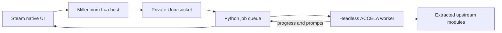

# ACCELA integration

Static analysis examined `deps.tar.gz` from [enter-the-wired](https://github.com/ciscosweater/enter-the-wired), internal version `20260512201930`, SHA-256 `16322a5309058e4dff5bee43518628f3c5bd4cae17b1651932d3ade1d47a7b71`. The artifact contains Python modules; binary decompilation was unnecessary. The AST [inventory](accela-inventory.json) lists module hashes, classes and functions without reproducing upstream source.

The original entry point creates a QApplication and may open a terminal even in CLI mode. Wired instead extracts the verified AppImage with 7zip, initializes QCoreApplication, imports functional modules and communicates over a JSON event stream. It does not call MainWindow or the upstream GUI entry point. A runtime layout change fails explicitly rather than silently opening a separate interface.

Jobs are sequential, with a cross-process lock, isolated working directories and process-group pause/resume/cancel. Partial game files are preserved on cancellation. Runtime preparation is indexed by artifact hash and reused. The runtime and all downloaded components remain outside the Git repository.

Coverage includes metadata/manifest lookup, library import, downloads, installation finalization, optional Steamless/Goldberg operations, achievements generation, and task prompts. Native SLSsteam integration and CloudRedirect configuration use independent adapters and do not require loading the ACCELA runtime.

Tests exercise actual extracted modules offline where the prepared runtime is available. They do not establish that every upstream provider is currently available or that all games install successfully.
